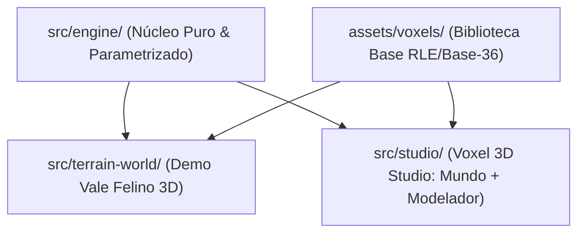

# Plano de Ação — PixelArt 3D Engine & Voxel 3D Studio

> Documento vivo de arquitetura e execução para evoluir o projeto de um mostruário hardcodado (`Vale Felino 3D`) para uma **engine 2.5D/3D Sprite-Stacking desacoplada** e um **Studio completo de navegador** (Editor de Mundo + Editor de Modelos Voxel + Exportador Autocontido).

---

## 1. Diagnóstico Atual e Arquitetura Alvo

### O que temos hoje
- `src/engine/` já possui 5 módulos extraídos (`00-math-noise.js`, `01-voxel-audio.js`, `02-slice-baker.js`, `03-terrain-sculptor.js`, `04-renderer.js`), mas parte da física, fluidos, resize e constantes do grid (`mw = 1080`, `mh = 1080`) ainda vivem em `src/terrain-world/`.
- `examples/studio.html` já tem pincéis ao vivo, vento/correnteza, seleção/trava (`pin`), `Novo Plano`, `Borracha` e `Undo`, porém o bundler `scripts/generate_studio.py` ainda inclui `src/terrain-world/*.js`, herdando o tamanho fixo `1080×1080`, a escala exagerada do gato e código do mostruário.

### Arquitetura Alvo (Separação Limpa)

### Política de Branches
- **`main` e `dev`**: permanecem intactas (estado estável do repositório/skill).
- **`dev-engine`**: refatorações puras de `src/engine/` e compatibilidade com `examples/terrain-world.html`.
- **`dev-studio`**: desenvolvimento do `Voxel 3D Studio` (`src/studio/`, `scripts/generate_studio.py`, `examples/studio.html` e este plano).

---

## 2. Fase 1 — Desacoplamento Total do Núcleo (`src/engine/`)

**Objetivo:** eliminar qualquer dependência de `src/terrain-world/` no Studio e tornar o tamanho do mapa e a física 100% configuráveis.

### Passos
1. **Parametrizar o Grid do Mundo (`initWorldGrid`):**
   - Trocar constantes fixas (`const mw = 1080`, `const mh = 1080`, `HALF_GRID`, `WORLD_MIN/MAX`) por um estado mutável/configurável (`initWorldGrid(gridW, gridH, voxSize, zMin, zMax)`).
   - Recriar dinamicamente `hmap`, `matMap`, `biomeMap`, `cliffMask`, `shadowMask`, `noGrassMask`, `standableMap`, `cliffTopMap`, `pinnedMask`, além das grades de vento/correnteza (`FLOW_GRID_W = Math.ceil(mw / FLOW_GRID_STEP)`) e dos caches de fatias em `02-slice-baker.js`.
   - Suportar presets de tamanho nativamente:
     - **Micro Diorama:** `128×128` (`256×256u`, bake ultra-rápido)
     - **Diorama:** `256×256` (`512×512u`)
     - **Ilha / Fase Média:** `512×512` (`1024×1024u`)
     - **Mundo Aberto:** `1080×1080` (`2160×2160u`)
2. **Extrair Física & Fluidos Genéricos para `src/engine/`:**
   - Criar `src/engine/05-physics-core.js`:
     - Movimento de entidade/player (colisão com terreno, `AUTO_STEP_MAX`, deslizamento tangencial, pulo com coyote time e jump buffer, gravidade configurável).
     - Colisores de props genéricos (`PROP_COLLIDER_META` extensível em runtime).
     - Destrutibilidade genérica (HP, impacto, queda rígida/balanço e spawn de drops) + **sistema de pegar/carregar/arremessar itens (`carry/throw`)**.
   - Criar `src/engine/06-fluids-weather.js`:
     - Campo de vento (`sampleWind`, `injectWindImpulse`, grade pintável `customWindVx/Vy`, `ENGINE_TUNING.windMul`).
     - Campo de correnteza (`sampleWaterFlow`, deflexão Rankine-dipole em obstáculos, grade pintável `customFlowVx/Vy`, streaks e flutuabilidade de Arquimedes).
     - Autômato granular (areia/talus), difusão térmica de fogo (`fireCool`) e tecidos/bandeiras Verlet.
3. **Manter `Vale Felino 3D` 100% íntegro:**
   - `src/terrain-world/` passa a conter apenas a configuração específica do Vale Felino (8 biomas, NPCs, peixes, galinhas, falas do gato, HUD do mostruário).
   - **Critério de aceite:** `python scripts/generate_terrain_world.py` + `python tests/test_physics_invariants.py` passando **5/5 `OK`** sem regressão visual ou física.

---

## 3. Fase 2 — Studio de Mundo Independente, Proporções & Humanoide de Teste

**Objetivo:** desligar `src/terrain-world/` do Studio e transformar `examples/studio.html` em um editor de mundos/dioramas de verdade.

### Passos
1. **Desligar `src/terrain-world/` de `scripts/generate_studio.py`:**
   - `generate_studio.py` passa a empacotar apenas `src/engine/*.js` + biblioteca base de assets (`assets/voxels/`) + `src/studio/*.js`.
   - Zero código de peixes, galinhas, HUD de biomas do Vale Felino ou pontes hardcodadas no Studio.
2. **Fluxo "Novo Projeto" (Modal/Barra):**
   - Escolher **Tamanho do Mapa:** `128×128 (Micro Diorama)`, `256×256 (Diorama)`, `512×512 (Médio)`, `1080×1080 (Grande)`.
   - Escolher **Base Inicial:**
     - `Plano Vazio` (grama em `Z=0`, sem props — modo 100% manual)
     - `Ilha Procedural` (relevo `fbm2d + ridgedFbm` com praia e água nas bordas)
     - `Terreno Continental` (colinas, vales e lagos internos)
   - Definir `WORLD_SEED` inicial.
3. **Proporções Reais & Avatares de Teste:**
   - **Humanoide Cru (Avatar Padrão de Teste):**
     - Modelo voxel limpo (cabeça, tronco, braços e pernas em fatias ou sub-partes articuladas) dimensionado em escala realista frente a portas, cabanas, árvores e toras (não gigante).
     - Animação de caminhada (passo/braços), pulo, golpe de quebra e pose carregando item.
   - **Gato (Avatar Alternativo):**
     - Escala padrão corrigida para **`0.45x`** (proporção realista de um gato ao lado de uma casa/humano), com slider de escala (`0.35x` até `1.2x`) no painel de Teste para quem quiser estilo chibi ou realista.
4. **Ações de Interação Separadas no Modo Testar:**
   - **Interagir — Quebrar (`Clique Esq` ou `F`):**
     - Atinge o prop destrutível à frente (árvore, pedregulho, tora, asset customizado com flag `destructible`), reduz HP, dispara partículas/som e gera drops físicos no chão.
   - **Interagir — Pegar / Soltar / Arremessar (`E`):**
     - Se mãos vazias: procura o item pegável (`pickable` ou drop de tora/pedra) mais próximo na frente do avatar e acopla acima da cabeça/mãos.
     - Se segurando item: solta suavemente (toque curto em `E`) ou arremessa na direção do olhar (segurar/apertar `F` ou `E` em movimento), reagindo à gravidade, terreno, vento e correnteza.
5. **Polimento das Ferramentas do Editor de Mundo:**
   - Adicionar **Redo (`Ctrl+Y` / `Ctrl+Shift+Z`)** junto ao `Undo (Ctrl+Z)`.
   - Atalhos rápidos de pincel (`[` e `]` para raio, `1..9` para ferramentas, `Espaço` no modo Editar para alternar rápido com Teste).
   - Seletor explícito de **Modo de Geração**: `Tudo Procedural` | `Híbrido (Fixo + Procedural)` | `Tudo Fixo (Manual)` com botão `Travar Tudo` / `Destravar Tudo`.

---

## 4. Fase 3 — Aba `🧱 Estúdio de Modelos Pixel` (Editor Voxel / Sprite-Stacking)

**Objetivo:** permitir que o usuário crie seus próprios props, itens pegáveis, estruturas e personagens pixel 3D dentro do mesmo `studio.html`, sem precisar de ferramentas externas.

### Passos
1. **Navegação por Abas na Topbar do Studio:**
   - **`🌍 Mundo`**: editor de terreno, fluidos, props e teste.
   - **`🧱 Modelador`**: editor de modelos voxel em fatias 2D empilhadas.
2. **Canvas de Edição por Camadas (`Z`):**
   - Dimensões suportadas: `16×16×16` (itens/objetos), `24×24×24` (personagens/props médios) e `32×32×32` (estruturas/árvores).
   - Slider + botões `▲/▼` para subir/descer fatia `Z`, com **Onion Skin** (camada `Z-1` visível semi-transparente abaixo para alinhar o volume 3D com precisão).
   - Ferramentas de pintura de fatia:
     - `✏️ Lápis` (voxel 1×1)
     - `🧽 Borracha`
     - `🪣 Balde (Flood Fill)`
     - `💉 Conta-Gotas`
     - `🪞 Espelho X` (simetria bilateral — essencial para personagens e móveis)
     - `📋 Copiar Fatia Anterior` / `⬆️ Duplicar para Z+1` / `🧹 Limpar Fatia`
3. **Editor de Paleta Indexada (Base-36):**
   - Paleta editável com cor `0` sempre transparente e até 35 cores sólidas (compatível 1:1 com o encoder Base-36/RLE da engine).
   - Presets prontos de paleta (Madeira, Folhagem, Pedra, Personagem/Roupas, Cozy Pastel).
   - Botão opcional de **Auto-Shading por Altura `Z`** (escurece sutilmente base e clareia topo).
4. **Preview 3D Giratório ao Vivo:**
   - Painel lateral renderizando o modelo em tempo real via `buildSliceSheet` + `stampModelSlice` (a mesma matemática de Sprite Stacking da engine).
   - Botão de **Auto-Girar**, arraste para orbitar `360°`, zoom e opção **"Comparar escala com Humanoide"** lado a lado.
5. **Propriedades de Comportamento & Biblioteca Dinâmica:**
   - Formulário compacto por asset:
     - Nome e ID do modelo
     - Categoria: `Prop Estático` | `Destrutível` (HP + drop) | `Item Pegável` | `Folhagem (Vento)` | `Fogo/Luz` | `Avatar de Teste`
     - Raio de colisão e escala padrão
   - Botão **`➕ Salvar na Biblioteca do Mundo`**: compila o `sliceSheet`, registra na paleta da Aba `🌍 Mundo` imediatamente e permite plantar no mapa (ou escolher como Avatar no modo Testar).
   - Importar / Exportar modelo individual no formato `.json` RLE compatível com `assets/voxels/`.

---

## 5. Fase 4 — Exportação de Projeto e Build Jogável Autocontido

**Objetivo:** fechar o ciclo de criação, permitindo salvar o trabalho em andamento ou publicar um diorama/jogo pronto.

### Passos
1. **Exportar / Importar Projeto Completo (`.voxelstudio.json`):**
   - Salva `version`, `gridW`, `gridH`, `voxSize`, `seed`, `generationMode`, `tuning`, `pinnedCells` (compactado em RLE), `windSparse`, `flowSparse`, `props` (fixos + procedurais se `Tudo Fixo`) e `customAssets` (todos os modelos criados no Modelador em formato RLE).
2. **Exportar HTML Autocontido (`🚀 Publicar .html`):**
   - Gera no próprio navegador um arquivo `.html` standalone contendo apenas o runtime mínimo (`src/engine/` + dados da cena exportada + avatar de teste escolhido + controles simples), sem sidebar de edição — pronto para abrir offline ou hospedar direto no GitHub Pages / itch.io.

---

## 6. Ordem de Execução & Verificação por Etapa

| Etapa | Entregável Principal | Verificação Obrigatória |
|---|---|---|
| **1A** | `initWorldGrid(w, h, vox)` em `src/engine/` | `terrain-world.html` gera `1080×1080` idêntico; teste em Node cria `128×128` e `256×256` sem erros |
| **1B** | `05-physics-core.js` e `06-fluids-weather.js` em `src/engine/` | `tests/test_physics_invariants.py` **5/5 `OK`** |
| **2A** | `generate_studio.py` sem `src/terrain-world/` + Modal Novo Projeto (tamanhos) | `node --check` saída `0`; alternar `256×256` ↔ `512×512` ↔ `1080×1080` sem travar |
| **2B** | Humanoide Cru + Gato `0.45x` + Ações `[Quebrar]` e `[Pegar/Soltar]` | Teste em modo Testar: cortar árvore, pegar tora, carregar, arremessar na água e ver boiar/derivar |
| **3** | Aba `🧱 Modelador Voxel` integrada à Biblioteca da Aba Mundo | Criar um prop/item no Modelador, salvar na biblioteca, plantar no mapa e interagir no modo Testar |
| **4** | Exportação `.voxelstudio.json` (com assets) + `.html` autocontido | Exportar cena, reimportar em aba limpa e abrir o `.html` exportado sem erros de console |
